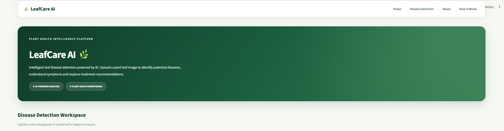
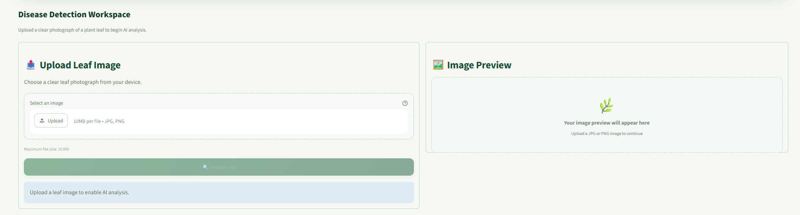
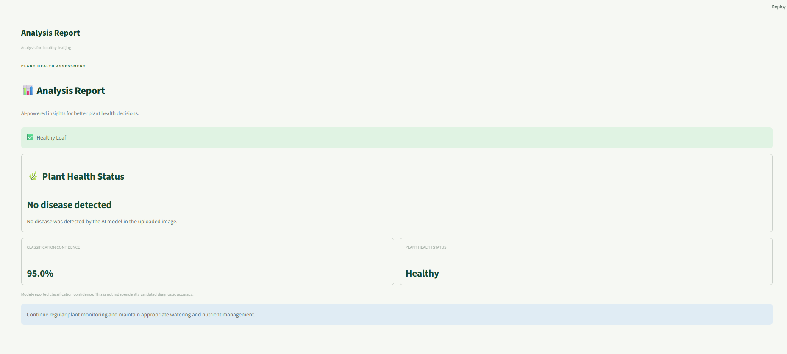
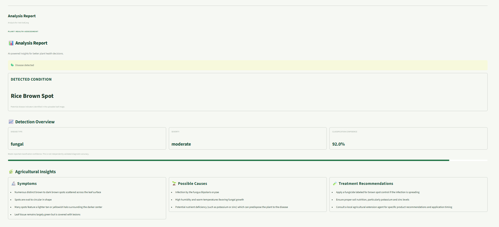
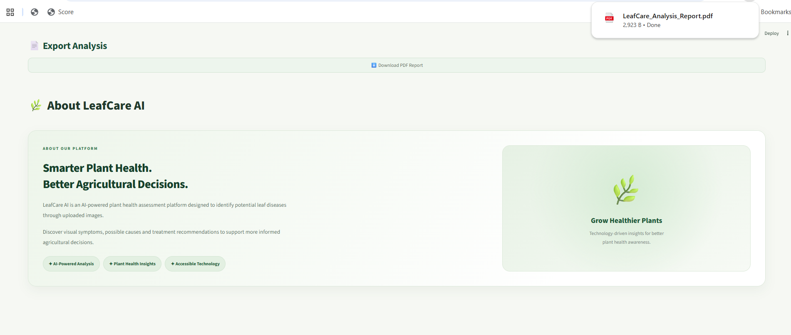

# 🌿 LeafCare AI

**AI-powered plant leaf disease detection and plant health analysis**

LeafCare AI is a web application that analyzes uploaded plant-leaf
images and returns an AI-generated assessment of possible disease
symptoms, plant health, severity, and practical care recommendations. It
combines a Streamlit interface, a FastAPI service, and Groq-hosted
vision AI.

> **Important:** Results are visual AI assessments, not laboratory
> diagnoses. Model-reported confidence is not independently validated
> diagnostic accuracy. Confirm important crop-health decisions with a
> qualified agricultural expert or local extension service.

```{=html}
<p align="center">
```
``{=html}
```{=html}
</p>
```
## ✨ Features

-   **Leaf image analysis:** Upload a JPEG or PNG leaf image for AI
    assessment.
-   **Health and disease classification:** Distinguishes healthy leaves,
    possible disease, severely damaged or dried leaves, and invalid or
    uncertain images.
-   **Detection details:** Displays the predicted condition, disease
    category, severity, and model-reported confidence when available.
-   **Agricultural insights:** Presents visible symptoms, possible
    causes, and treatment or care recommendations.
-   **Image preview:** Preview the selected image before analysis.
-   **PDF export:** Download a formatted analysis report.
-   **Input validation:** Checks image type and size before processing.
-   **API error handling:** Returns clear errors for invalid uploads,
    unexpected failures, and temporary AI-provider quota limits.

## 🖼️ Application Screenshots

### Homepage



### Image upload and preview



### Healthy leaf analysis



### Disease analysis



### PDF report export



## 🧱 Architecture

``` text
User
 │
 ▼
Streamlit frontend (main.py)
 │  multipart image upload
 ▼
FastAPI backend (app.py)
 │
 ├── Image validation and normalization
 │
 ▼
Utility layer (utils.py)
 │
 ▼
LeafDiseaseDetector
(Leaf Disease/main.py)
 │
 ▼
Groq Vision API
 │
 ▼
Structured analysis response
 │
 ▼
Streamlit results + PDF report
```

## 🛠️ Technology Stack

  Component             Technology
  --------------------- ------------
  Frontend              Streamlit
  Backend API           FastAPI
  API server            Uvicorn
  Vision AI inference   Groq API
  Image processing      Pillow
  PDF generation        ReportLab
  Language              Python

The vision model is configured in the project's detector/configuration
files. Check those files for the exact model identifier used by your
current setup.

## 📁 Project Structure

``` text
leaf-disease-detection/
├── .streamlit/
│   └── config.toml
├── Leaf Disease/
│   ├── config.py
│   └── main.py
├── Media/
│   ├── readme-homepage.png
│   ├── readme-image-upload.png
│   ├── readme-healthy-result.png
│   ├── readme-disease-result.png
│   ├── readme-pdf-report.png
│   └── leafcare-demo.mp4
├── app.py
├── main.py
├── utils.py
├── test_api.py
├── requirements.txt
├── .env.example
├── .gitignore
├── LICENSE
└── README.md
```

Additional sample images or model assets may also be present in the
repository.

## 🚀 Run Locally

### 1. Prerequisites

-   Python 3.10 or newer (use a Python version supported by all packages
    in `requirements.txt`).
-   Git.
-   A Groq API key. Create one from the [Groq
    Console](https://console.groq.com/).

### 2. Clone the repository

``` bash
git clone https://github.com/divyanshuagrawal1/leaf-disease-detection.git
cd leaf-disease-detection
```

### 3. Create and activate a virtual environment

**Windows PowerShell**

``` powershell
python -m venv venv
.\venv\Scripts\Activate.ps1
```

**macOS / Linux**

``` bash
python -m venv venv
source venv/bin/activate
```

### 4. Install dependencies

``` bash
python -m pip install -r requirements.txt
```

### 5. Configure the API key

Copy `.env.example` to `.env` and add your own key:

``` env
GROQ_API_KEY=your_groq_api_key_here
```

Keep `.env` private. It must never be committed to GitHub. The
repository's `.gitignore` should exclude it.

### 6. Start the FastAPI backend

Open a terminal in the project root:

``` bash
python -m uvicorn app:app --reload --host 127.0.0.1 --port 8000
```

-   API root: http://127.0.0.1:8000/
-   Interactive API documentation: http://127.0.0.1:8000/docs

### 7. Start the Streamlit frontend

Open a second terminal, activate the same virtual environment, and run:

``` bash
python -m streamlit run main.py --server.port 8501
```

Open http://localhost:8501 in your browser.

## 🔌 API

### `GET /`

Returns API information and service status.

### `POST /disease-detection-file`

Accepts an image upload using `multipart/form-data`.

  Property              Details
  --------------------- --------------------------
  Form field            `file`
  Accepted formats      JPEG and PNG
  Maximum upload size   10 MB
  Success response      Structured JSON analysis

The response can include fields such as `disease_detected`,
`disease_name`, `disease_type`, `severity`, `confidence`, `symptoms`,
`possible_causes`, and `treatment`, depending on the classification
result.

Common validation and service responses include:

  HTTP status     Meaning
  --------------- ----------------------------------------------
  `200`           Analysis completed
  `400`           Empty, corrupt, or invalid image
  `413`           Upload exceeds the size limit
  `415`           Unsupported image format
  `429`           AI provider quota/rate limit reached
  `500` / `502`   Unexpected server or analysis response error

## 🧪 Testing

Start the FastAPI backend before running endpoint integration tests.

``` bash
python -m pytest -v
```

Some image-analysis integration tests call the live Groq API and
therefore require a valid API key, network access, and available
provider quota. Avoid repeatedly running live tests when the provider
quota is limited.

## ☁️ Deployment

The planned deployment architecture is:

-   **Backend:** Render (FastAPI service)
-   **Frontend:** Streamlit Community Cloud

Deployment is not represented as live until the services have been
deployed and their public URLs have been added here.

### Render backend start command

``` bash
uvicorn app:app --host 0.0.0.0 --port $PORT
```

Configure `GROQ_API_KEY` as a secret environment variable in the Render
dashboard. Do not put the key in source code or the README.

For Streamlit Community Cloud, connect this GitHub repository, select
`main.py` as the app entry point, and configure the backend API URL and
any required secrets using the platform's secrets/settings mechanism.
The frontend must point to the deployed Render API rather than
`127.0.0.1`.

**Live application:** *To be added after deployment.*

## 🔐 Security and Usage Notes

-   Never commit `.env`, API keys, passwords, or provider tokens.
-   Use environment variables or the deployment platform's secret
    manager for credentials.
-   Upload clear, well-lit images focused on the leaf.
-   AI predictions may be incorrect or uncertain. Do not use them as the
    sole basis for pesticide selection or other high-impact agricultural
    decisions.
-   Groq quota limits may temporarily prevent analysis. The application
    reports this as an API rate-limit response.

## 👨‍💻 Maintainer

**Divyanshu Agarwal**

-   GitHub: [@divyanshuagrawal1](https://github.com/divyanshuagrawal1)
-   Repository:
    [leaf-disease-detection](https://github.com/divyanshuagrawal1/leaf-disease-detection)

## 📜 License and Attribution

This repository retains the original **MIT License**. Review the
included [`LICENSE`](LICENSE) file for the applicable copyright and
permission notice.

This project is based on and extends the original MIT-licensed Leaf
Disease Detection project by [Shukur
Alam](https://github.com/shukur-alom). The original copyright and
license notice are retained in the repository. The current interface,
integration, validation, reporting, and deployment preparation have been
customized for LeafCare AI.

## 🙏 Acknowledgements

-   [Groq](https://groq.com/) for hosted AI inference.
-   [FastAPI](https://fastapi.tiangolo.com/) for the backend framework.
-   [Streamlit](https://streamlit.io/) for the interactive application
    interface.
-   The Python open-source ecosystem and the original project author.
